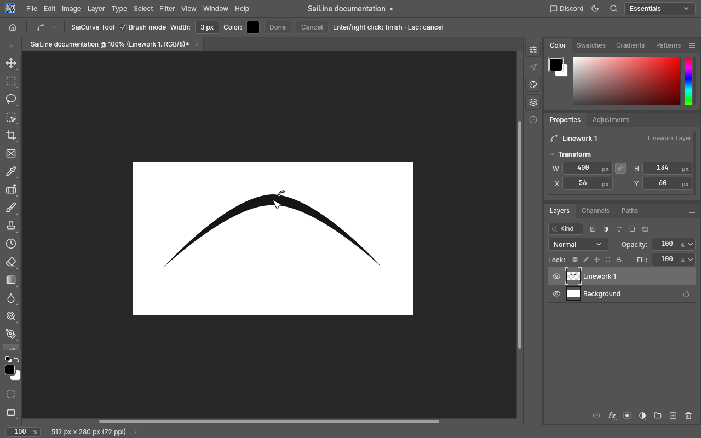
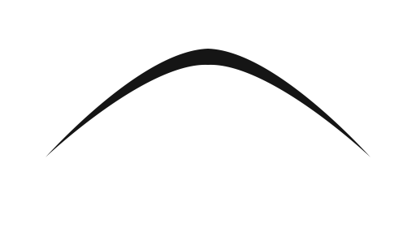
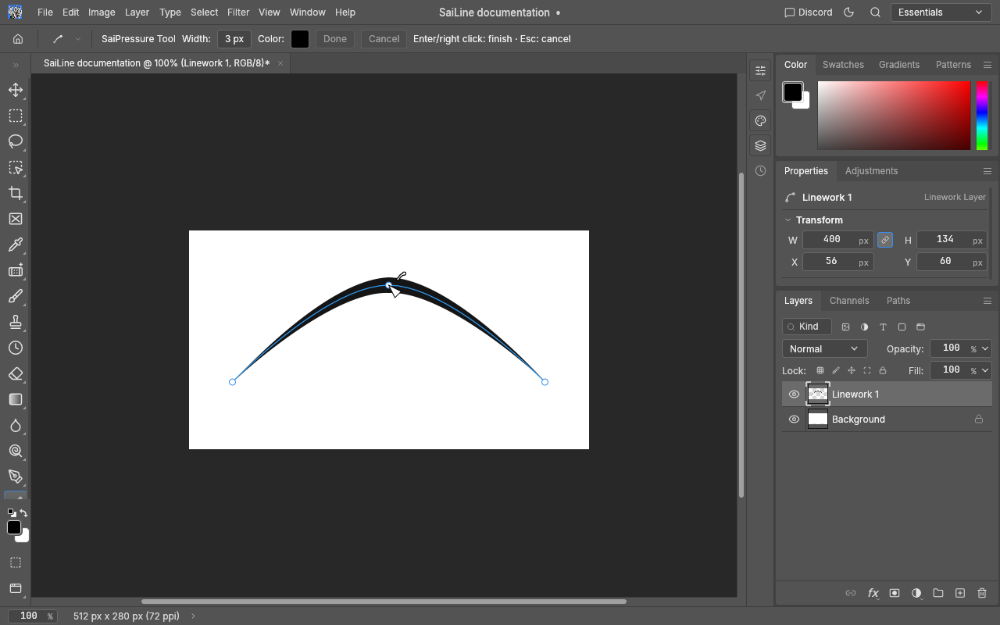
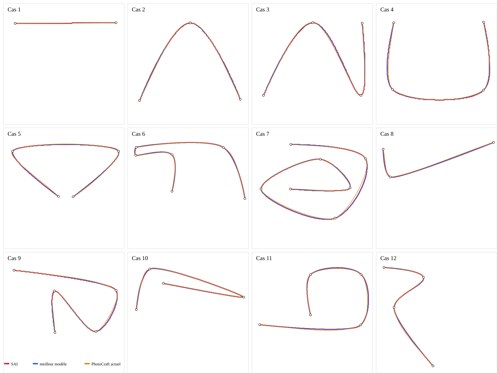
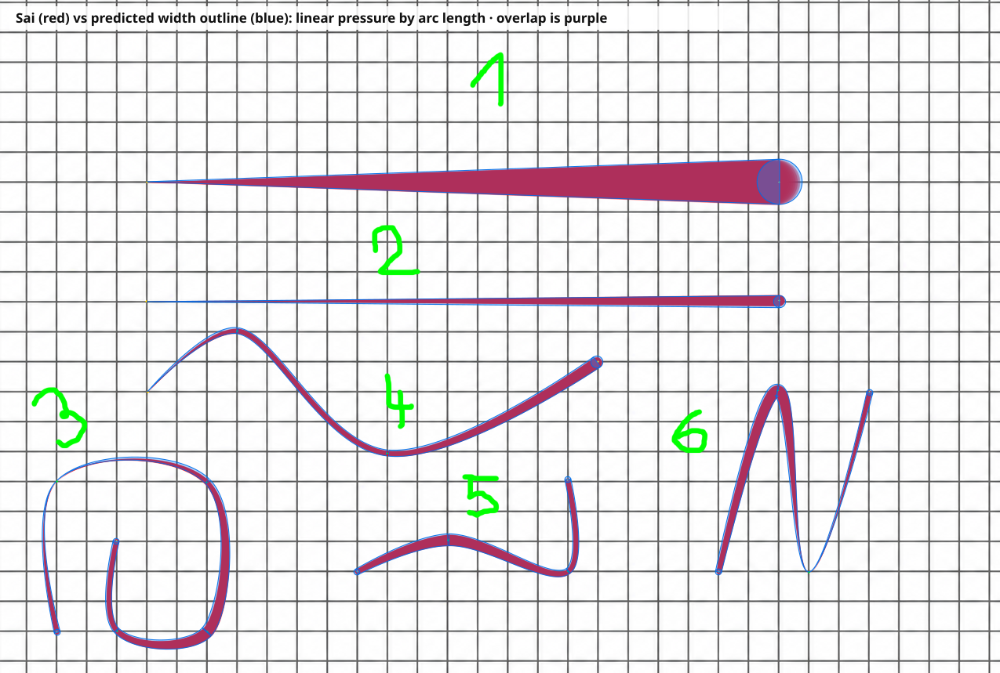

# SaiLineArt — guide utilisateur et référence des fonctionnalités

SaiLineArt est l’éditeur de tracés vectoriels de PhotoCraft inspiré du Linework de PaintTool SAI 1.2.6 Beta 3. Les tracés restent composés de points de contrôle éditables : ils ne sont pas convertis en pixels pendant le dessin, le déplacement ou la transformation.

Dans ce document, **SaiLineArt** désigne l’ensemble de la famille d’outils ; **SaiLine** est l’outil de création de segments droits. Ce document décrit le comportement présent dans PhotoCraft. Les ressemblances avec SAI sont signalées comme observées ou validées avec les références disponibles ; elles ne signifient pas que la formule propriétaire de SAI a été retrouvée.

Pour l’architecture, les mesures de performance, les limites connues et les étapes de reprise du développement, consulter le [dossier développeur SaiLineArt](sailineart-development.md).

## Vue d’ensemble

SaiLineArt regroupe sept outils qui éditent le même modèle de tracé :

| Outil affiché | Rôle |
|---|---|
| **SaiCurve** | Créer une courbe interpolée et régler sa largeur de base. |
| **SaiPressure** | Modifier la pression des points, de 0 à 200 %. |
| **SaiLine** | Créer un tracé composé de segments droits et de jonctions arrondies. |
| **SaiWeight** | Appliquer une largeur de base à tout un tracé. |
| **SaiCombine** | Raccorder les extrémités de deux tracés du même calque Linework. |
| **SaiPointed** | Basculer le point visé entre une jonction courbe et un angle dur. |
| **SaiColor** | Appliquer la couleur de premier plan à tout un tracé. |

Les outils de modification travaillent sur les points ou le tracé visé. Les commandes communes d’insertion, de déplacement et de suppression restent disponibles quel que soit l’outil actif.

## Créer un tracé

1. Choisir **SaiCurve** ou **SaiLine** dans la barre d’outils.
2. Cliquer successivement sur le canevas pour placer les points. Le pointeur prévisualise la suite du tracé.
3. Régler la largeur, la couleur et, pour SaiCurve, éventuellement **Brush mode** dans la barre d’options.
4. Valider avec **Entrée**, **Done** ou un clic droit simple. **Échap** ou **Cancel** annule le brouillon.

Deux points au minimum sont requis ; un tracé accepte jusqu’à 4096 points. Les clics rapprochés reçus dans une même frame sont tous conservés. Le brouillon n’altère pas le document avant sa validation. **Retour arrière** retire le dernier point du brouillon ; **Ctrl+Z** et **Ctrl+Y** retirent et restaurent les points du brouillon sans modifier l’historique du document. Quitter l’outil ou changer de document abandonne le brouillon.

La largeur de base est réglable de **0,7 à 30 px** et la couleur vient du sélecteur de premier plan de PhotoCraft. Un nouveau tracé est ajouté au calque Linework actif ; en l’absence d’un tel calque actif, PhotoCraft en crée un. Un calque Linework peut contenir plusieurs tracés indépendants.

Pendant la création, le dernier point prévisualisé suit la position du pointeur. Cette poignée de prévisualisation n’est pas enregistrée comme un point supplémentaire lorsque le tracé est validé.

### Mode pinceau de SaiCurve

La case **Brush mode** est désactivée par défaut. Lorsqu’elle est active, un tracé SaiCurve d’au moins trois points reçoit une pression de **0 % au premier et au dernier point**, et de **100 % aux autres points**. La largeur de base ne change pas : elle reste la largeur habituelle sur le corps du trait et s’effile vers les extrémités. Un tracé à deux points, qui ne contient qu’un segment, conserve ses extrémités normales. Le mode ne s’applique pas à SaiLine.



Un export du seul tracé, sans interface ni points de contrôle, est disponible ici :



## Éditer les points et les tracés

Les points ont des identifiants stables. La sélection temporaire référence ces identifiants, de sorte que les opérations d’édition ne perdent pas leur cible lorsque la liste de points change.

| Interaction | Résultat |
|---|---|
| Clic sur un point | Sélectionner ce point. |
| **Shift** + clic sur un point | Ajouter ou retirer ce point de la sélection. |
| **Shift** + glisser depuis une zone libre | Tracer une sélection rectangulaire additive. |
| **Ctrl** + glisser un point | Déplacer le point ; si plusieurs points sont sélectionnés, les déplacer ensemble. |
| **Ctrl** + clic sur un segment | Insérer un point sur la courbe ou la ligne. |
| Continuer le geste en **Ctrl** + glissant après l’insertion | Insérer le point puis le déplacer immédiatement. |
| **Alt** + clic sur un point | Supprimer le point ; si ce point appartient à la sélection multiple, supprimer la sélection. |
| **Alt** + clic sur un segment intérieur | Supprimer le segment et partager le tracé en deux tracés, en gardant les points de part et d’autre. |
| **Alt** + clic sur le premier ou le dernier segment | Retirer l’extrémité correspondante, ce qui raccourcit le tracé d’un segment. |
| Clic droit avec **Ctrl**, **Alt** ou **Shift** | Désélectionner la sélection SaiLineArt active. |
| **Suppr** ou **Retour arrière** avec une sélection | Supprimer tous les points sélectionnés en une opération. |

La suppression du seul segment d’un tracé à deux points supprime le tracé. La suppression d’un segment intérieur conserve ses points de contrôle et crée deux chemins distincts. Les raccourcis de modification partagés ont priorité sur l’action propre à l’outil : par exemple, Ctrl+clic avec SaiColor insère un point au lieu de recolorer le tracé.



Le squelette bleu n’est affiché au survol que lors d’une interaction avec modificateur. Avec **SaiPressure**, les points restent visibles pour rendre l’outil utilisable, et le squelette du tracé survolé est affiché. Les repères complémentaires suivent l’indicateur de l’outil dans le canevas.

Quand un modificateur est tenu, le pointeur indique l’action disponible près de sa cible : **Ctrl** sur un segment annonce l’insertion, **Ctrl** sur un point le déplacement, et **Alt** sur un point ou un segment la suppression. Les poignées d’une sélection simple utilisent l’accent bleu ; pendant une sélection multiple, les points concernés et les segments reliant deux points sélectionnés sont signalés en rouge. Hors SaiPressure, les poignées se masquent lorsque les modificateurs sont relâchés.

### Comportement des sept outils

#### SaiCurve

Crée une courbe avec le modèle **SAI simplifié** décrit plus bas. La largeur et la couleur choisies s’appliquent au tracé. La case Brush mode permet d’effiler le premier et le dernier point à 0 % sur les tracés d’au moins deux segments.

#### SaiLine

Crée une ligne vectorielle segment par segment. Les points restent sélectionnables et modifiables comme ceux d’une SaiCurve. Les jonctions de trait demeurent arrondies, même quand les segments sont droits.

#### SaiPressure

Cliquer sur un point le sélectionne. **Glisser horizontalement** ajuste sa pression : vers la gauche pour diminuer, vers la droite pour augmenter, avec une plage utilisateur de **0 à 200 %**. Un clic sans déplacement ne change pas la valeur. Une pression de 100 % correspond à la largeur de base ; 0 % donne une épaisseur nulle au point et 200 % le double.

La sélection multiple permet d’appliquer le même glissement à plusieurs points. La pression est prévisualisée pendant le geste et la valeur exacte du relâchement est enregistrée dans une seule opération d’historique. Les recalculs d’aperçu sont limités à environ 30 par seconde pour garder le glissement réactif. La valeur de base et la pression restent indépendantes.

#### SaiWeight

Un clic sur un point ou un segment applique la largeur de base indiquée dans la barre d’options à tout le tracé ciblé. La valeur est bornée à 0,7–30 px. Cet outil n’édite pas la pression des points.

#### SaiColor

Choisir une couleur de premier plan dans le sélecteur de PhotoCraft puis cliquer sur un tracé pour en recolorer tout le chemin. La couleur appartient au tracé ; cette action ne modifie ni ses points, ni ses pressions, ni sa largeur.

#### SaiPointed

Cliquer sur un point inverse son état entre une jonction courbe et un angle dur. L’angle est construit avec des tangentes de part et d’autre du point ; le raccord du contour du trait reste arrondi. Les points voisins et leurs autres propriétés ne sont pas remplacés.

#### SaiCombine

Cliquer sur une extrémité, puis sur l’extrémité d’un autre tracé du même calque Linework. Les deux chemins deviennent un seul chemin ; leur sens est adapté pour raccorder les extrémités choisies. Si les deux extrémités sont déjà superposées, le doublon du point de raccord est éliminé. L’opération est annulable.

## Transformation Ctrl+T

Sélectionner un ou plusieurs points, puis activer **Ctrl+T** (ou le raccourci de transformation de la plateforme). Le cadre entoure les coordonnées des points sélectionnés, sans inclure la silhouette complète du trait. Si aucun point n’est sélectionné, l’activation depuis SaiLineArt sélectionne les points de tous les tracés du calque Linework actif.

- Glisser dans le cadre déplace les points.
- Les poignées latérales étirent un axe ; les poignées d’angle redimensionnent les deux axes.
- **Shift** sur un coin conserve les proportions.
- Glisser à l’extérieur du cadre fait pivoter la sélection autour de son centre ; **Shift** contraint la rotation par pas de 45°.
- Le cadre et les courbes transformées sont prévisualisés en direct.
- **Entrée** valide ; **Échap** annule et restaure les positions initiales.

La transformation agit sur les coordonnées des points seulement. Elle ne change ni les pressions, ni la largeur de base, ni les couleurs, ni l’ordre, ni les états SaiPointed. Les courbes et leur contour de largeur variable sont recalculés depuis les points à chaque aperçu. Un glissement complet constitue une seule opération Undo ; le Redo réapplique les positions transformées.


La déformation libre au sens d’une transformation arbitraire des quatre coins n’a pas fait l’objet d’une validation SAI Linework dédiée ; ne pas l’assimiler à un comportement SAI confirmé.

## Modèle géométrique et rendu

### Interpolation par défaut

SaiCurve utilise **SAI simplifié**. Le moteur construit une spline cubique locale passant par les points. Pour un point intérieur, la tangente combine les directions des segments voisins paramétrés par leur longueur à la puissance `α = 1/3`, puis module son amplitude par le rapport des longueurs à la puissance `β = 1/2`. La tension `−0,2` multiplie la tangente par `1,2`. Les deux tangentes d’extrémité sont nulles pour une chaîne de plus de deux points ; à deux points, le tracé reste droit. Les points superposés et les angles SaiPointed ont des règles dédiées.

La formule est celle du moteur expérimental conservé dans le dépôt. L’étude a reconstruit douze exemples de SAI et comparé uniform, centripète, chordal, plusieurs tensions et variantes d’extrémité. La formule simple a obtenu un score moyen équilibré de **0,470 px**, contre **1,845 px** pour l’algorithme PhotoCraft antérieur sur les références étudiées. Le modèle optimisé (`α = 0,3375`, `β = 0,4875`, tension `−0,2`) reste dans le banc, mais n’est pas sélectionnable dans l’interface finale. Ces mesures indiquent une forte proximité sur ces images ; elles ne prouvent pas la formule propriétaire de SAI.

La construction est réversible à l’inversion de l’ordre, interpolante, et locale : le déplacement d’un point n’affecte que les quatre segments voisins au maximum. Des tests couvrent les longueurs très inégales, points confondus, angles, continuité, coordonnées non finies et stabilité. Les courbes à boucles intentionnelles restent autorisées.

La largeur de base est une propriété du chemin ; chaque point stocke en plus un facteur de largeur (`1.0` = 100 %). L’épaisseur locale vaut `largeur de base × facteur`. Le rendu interpole la pression le long de la longueur d’arc de chaque segment, calcule le contour depuis les normales locales et ajoute un disque terminal de diamètre correspondant à l’épaisseur locale non nulle. Un point à 0 % reste un point de contrôle et ne disparaît pas de la géométrie.

Les six références de pression ont départagé certaines lois, mais pas de façon concluante : l’interpolation linéaire en longueur d’arc a devancé l’interpolation en paramètre Bézier de 0,071 px, une différence inférieure à l’incertitude estimée de ±1,5 px. La longueur d’arc est utilisée dans le rendu actuel après essais interactifs ; l’équivalence exacte des jointures et recouvrements avec SAI n’est pas affirmée.





## Calques, fichiers et historique

Un calque **Linework** contient plusieurs tracés indépendants. Le modèle persistant conserve les points, les identifiants, les pressions, l’état Pointed, la couleur et la largeur de base. Les contours et caches raster sont dérivés et ne remplacent pas les données vectorielles. La pression absente d’un ancien document est lue comme 100 %.

Les documents `.pcraft` préservent les tracés éditables. Undo/Redo couvre les créations, déplacements, transformations, modifications de pression et de largeur, recolorations, insertions, suppressions, changements Pointed et raccordements. Les aperçus interactifs réutilisent des caches par tracé ; les changements d’un point ne doivent pas faire disparaître les autres chemins du calque ni afficher un doublon pendant le glissement.

Pour convertir le calque en pixels, faire un clic droit sur le calque Linework et choisir **Rasterize Layer**. Cette conversion retire l’édition par points du résultat raster ; elle reste une opération de document annulable.

## Référence des commandes moteur

Ces commandes sont les opérations natives du moteur, également utilisées par l’interface SaiLineArt. Leur paramétrage complet est décrit dans `crates/engine/src/linework_cmds.rs`.

| Commande | Fonction |
|---|---|
| `linework.create` | Créer un tracé à partir de points, largeur, couleur, facteurs et modèle. |
| `linework.movePoint`, `linework.movePoints` | Déplacer un point ou un ensemble en une transaction. |
| `linework.insertPoint` | Insérer une ancre avec position et pression initiale. |
| `linework.deletePoint`, `linework.deletePoints` | Supprimer un ou plusieurs points. |
| `linework.deleteSegment` | Retirer un segment, raccourcir une extrémité ou scinder le chemin. |
| `linework.setPointWidth`, `linework.setPointWidths` | Modifier un ou plusieurs facteurs de pression. |
| `linework.setPathWidth` | Modifier la largeur de base. |
| `linework.setPathColor` | Recolorer un chemin entier. |
| `linework.setPointPointed` | Modifier l’état courbe/angle d’un point. |
| `linework.combinePaths` | Raccorder deux extrémités. |
| `linework.setInterpolation` | Recalculer les caches avec un modèle expérimental ; aucune commande de sélection n’est exposée dans l’interface finale. |

Le code est séparé entre le modèle persistant (`crates/doc/src/linework.rs`), la géométrie et le contour (`crates/vector/src/linework.rs`), les commandes/historique (`crates/engine/src/linework_cmds.rs`) et l’interface (`crates/ui-egui/src/sailine_ui.rs`, `transform_tool.rs`, `canvas.rs`).

## Limites connues et vérifications

- La pression du stylet n’est pas mappée automatiquement à `width_factor` ; SaiPressure s’utilise par glissement horizontal.
- Les cas de fortes pressions, d’extrémités à 0 %, de retours très courts et d’auto-recouvrements sont testés, mais la rasterisation n’est pas déclarée pixel-identique à SAI.
- La déformation libre des points n’est pas revendiquée comme parité vérifiée avec SAI.
- Le clic/déplacement des points SaiLineArt vise le calque Linework actif ; le cadre Ctrl+T sait transformer les identifiants de points capturés et ne met pas les traits à l’échelle.
- Brush mode s’applique uniquement aux nouveaux tracés SaiCurve validés avec l’option activée ; il ne retouche pas automatiquement les extrémités de tracés déjà présents.

Les bancs reproductibles sont conservés dans [`experiments/sailine_sai126/`](../experiments/sailine_sai126/README.md) et [`experiments/sailine_width/`](../experiments/sailine_width/README.md). Ils contiennent jeux de données, scripts, diagnostics, scores et planches de comparaison.

Pour lancer PhotoCraft depuis le dépôt :

```sh
CARGO_HOME=/mnt/SSD2/Codex/.tooling/cargo cargo run -p photocraft --offline
```

Choisir SaiCurve et créer une courbe ; tester SaiPressure sur ses points ; sélectionner quelques points puis utiliser Ctrl+T. Le calque Linework reste éditable jusqu’à sa rasterisation.
